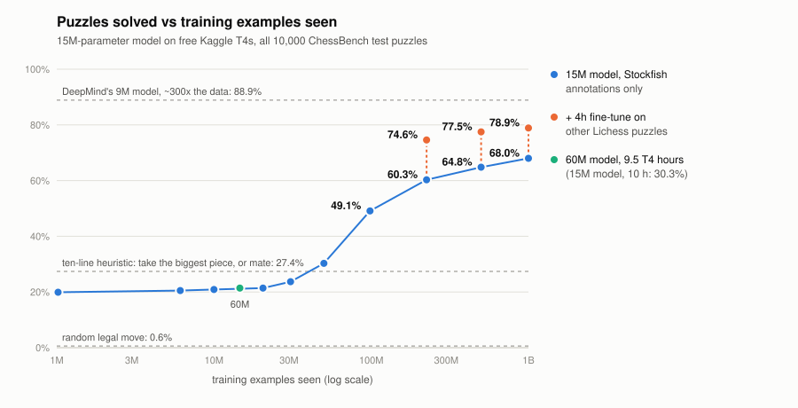

# gpt-from-scratch

A decoder-only Transformer **built from scratch in PyTorch**, pointed at chess, then
made **fast** -- with reproducible configs, benchmarks, and the run logs behind the
numbers in [`results/`](results/).

Every block (attention, MLP, LayerNorm, positional embeddings, the AdamW param
grouping) is hand-written in [`src/model.py`](src/model.py) -- no `from transformers
import` of the model. The fused LayerNorm in [`src/kernels/`](src/kernels/) is
hand-written too, in Triton.

Hand-written is not the same as unprecedented, so: the model's skeleton follows
Karpathy's [nanoGPT](https://github.com/karpathy/nanoGPT) (MIT) and the fused kernel's
two-stage backward follows Triton's `05-layer-norm` tutorial (MIT). The chess task,
the action-value head, the data path, the search and the bot are this project's.
Ideas reimplemented from DeepMind's ChessBench are listed in [`NOTICE`](NOTICE).

## In two minutes

A 15M-parameter Transformer, written from scratch, reads a chess position and a move
and predicts how good the move is. It learned from Stockfish annotations on free
Kaggle GPUs, and it plays without search: one forward pass per legal move.

- **68.0%** of 10,000 Lichess test puzzles solved after 1B training examples (64.8%
  at 500M).
- **78.9%** after a 4-hour fine-tune of the 1B model on other Lichess puzzles. The
  same fine-tune gives the 500M model 77.5%, or 78.1% when it also has to stay close
  to the model it started from.
- **27.4%** for a ten-line rule that grabs the most valuable hanging piece. Every
  model trained on fewer than 50M examples scores below it.
- **1855** rapid on Lichess, as the bot [`imbotterthanyou`](https://lichess.org/@/imbotterthanyou)
  (a tree search of 64 network calls per move on top of the 1B model), after 43 games in
  one Kaggle CPU session: a performance of 1933 (1830 to 2048), against 1804 (1720 to
  1892) for the earlier alpha-beta at depth 2. In blitz against bots, the category of the
  paper's 2054 (played without search), 60 games give 1784 (1691 to 1872).
- **1.86x** training throughput from the second T4 of a Kaggle session, at no extra quota.

<picture>
  <source media="(prefers-color-scheme: dark)" srcset="results/curve_dark.svg">
  
</picture>

What turned out to be hard:

- **Data buys less each time.** From 50M to 100M examples the score rose 18.8 points,
  to 225M another 11.2, to 500M another 4.5, and to 1B another 3.2.
- **Search helps until the puzzle fine-tune.** Depth 2 adds 2.3 points (standard
  error 0.22) to the 500M model and takes 1.2 away (0.39) from its fine-tune, on the
  same 10,000 puzzles. The fine-tune's leaves are the cause: under the fine-tune's root
  the base model's leaves turn the loss into a 0.7-point gain (0.35). In games, search is
  the largest lever here: depth 2 beats the bare network by 165 Elo, a tree search beats
  depth 2 by 115, and doubling its simulations adds 56
  ([Search](#search-and-the-lichess-bot)).
- **The metric was the bug.** For ten days every accuracy here measured the opponent's
  moves, because the test compared a field with a restatement of itself. A baseline
  run on the same puzzles is what showed most models were weaker than they looked.

The main path follows; every experiment behind it, with its caveats, is in
[`EXPERIMENTS.md`](EXPERIMENTS.md).

## The result

The model reads a chess position and a candidate move and predicts how good the move
is, learning from Stockfish 16 annotations (DeepMind's ChessBench). No search, no
rollouts -- one forward pass per legal move, best expected value wins. 15M parameters
(14.19M non-embedding), 8 layers, 384 dim, a 1,999-symbol vocabulary (31 FEN symbols
plus 1,968 UCI moves), 78 tokens per sample (77 for the position, 1 for the move), and
a 64-way classification head over buckets of the Stockfish win probability.

**68.0% of Lichess puzzles solved** -- 6,801 of the 10,000 ChessBench test puzzles --
after 1B training examples of Stockfish annotations on free Kaggle GPUs
([`results/36_chess_1B_eval.json`](results/36_chess_1B_eval.json)); 64.8% at 500M
([`results/24_chess_500M_eval.json`](results/24_chess_500M_eval.json)), 60.3% at 225M.

**78.9%** (7,889 of 10,000) after a 4-hour fine-tune of the 1B checkpoint on *other*
Lichess puzzles ([`results/37_results_1B_w03.json`](results/37_results_1B_w03.json)),
with a ranking loss over the legal moves added on top of the original one at 0.3 of its
weight. The same fine-tune took the 500M checkpoint to 77.5%
([`results/26_puzzle_finetune_500M_w0.3.json`](results/26_puzzle_finetune_500M_w0.3.json)),
and at full weight the 225M one to 74.6%. The 10,000
test puzzles were excluded by id before packing (9,995 of them are in the Lichess
database; the packer asserts that the exclusion removed something), and the checkpoint
was chosen by the action-value validation loss, never by puzzle accuracy. All of these
numbers come from one evaluator, which reproduced earlier measurements exactly when it
was rerun (results/17).

Those numbers answer different questions. 68.0% is what Stockfish's annotations alone
teach, which is the setting of DeepMind's paper. 78.9% is what the model does once it
has also been told which move solves a puzzle -- more useful, and no longer comparable
to the paper, which never trains on puzzles.

Neither is readable without a baseline, which is why the headline here is puzzle
accuracy and not a validation loss. Two baselines run on the same 10,000 puzzles: a
ten-line rule that grabs the most valuable hanging piece, or mates when it can, solves
**27.4%**, and picking a legal move at random solves **0.6%**.

### The curve

The point of the project is the curve, not the single number -- how much accuracy an
hour of free GPU buys (the plot is at the top):

| model | examples | T4 hours | puzzles solved | val loss |
|---|---|---|---|---|
| 15M | 1M | 0.2 | 19.9% | 3.234 |
| 15M | 6.1M | 0.9 | 20.5% | 3.088 |
| 15M | 10M | 1.5 | 20.9% | 3.036 |
| 15M | 20.5M | 3.9 | 21.4% | 2.911 |
| 15M | 30.7M | 5.3 | 23.7% | 2.751 |
| 15M | 50M | 10.0 | 30.3% | 2.5432 |
| 15M | 100M | 21.4 | 49.1% | 2.2419 |
| 15M | 225M | -- | 60.3% | 2.0557 |
| 15M | 500M | 23.8 on two T4s | 64.8% | 1.9371 |
| 15M | **1B** | 42.3 on two T4s | **68.0%** | **1.9015** |
| 15M | 225M + 12k puzzle steps | 4.2 | 74.6% | 2.0562 |
| 15M | 500M + 12k puzzle steps, ranking at 0.3 | 4.1 | 77.5% | 1.9395 |
| 15M | 500M + the same 12k steps, no puzzles | 2.3 | 64.9% | 1.9287 |
| 15M | 500M + 12k puzzle steps, ranking at 0.3, distilled from the 500M | 5.3 | 78.1% | 1.9349 |
| 15M | 1B + 12k puzzle steps, ranking at 0.3 | 3.8 | **78.9%** | 1.9063 |
| 60M | 14.6M | 9.5 (whole run) | 21.4% | 2.986 |

Every row is measured on all 10,000 puzzles with one evaluator. **Every model below 50M
examples scores worse than the ten-line rule**, and returns diminish: doubling from 50M
to 100M examples bought 18.8 points, the last doubling 3.2. Training details, the
puzzle fine-tune's cost in ordinary positions and in games, results by difficulty and
move by move, and why a larger model was the wrong lever on this budget are in
[EXPERIMENTS.md](EXPERIMENTS.md#puzzles-and-training).

### Distance to the paper

DeepMind's ChessBench reaches **88.9%** on these puzzles with a **9M**-parameter model
-- smaller than this one, on the same data and the same task. The difference is
training examples seen: the paper trains for 10 million steps of 4,096, about 41 billion
examples, 41 times this run's 1 billion. 68.0% from free T4s is a
budget result, not an architecture result, and the curve above is the honest way to
read it.

The paper's Table 1 (arXiv [2402.04494](https://arxiv.org/abs/2402.04494) v2) also puts
other engines on Lichess, blitz against bots, the category of
[results/44](results/44_lichess_mcts64_blitz_session.json), and on the same 10,000 puzzles:

| agent | trained on | search | Lichess blitz vs bots | puzzles |
|---|---|---|---|---|
| ChessBench 9M (DeepMind) | ~41B Stockfish-annotated examples | none | 2054 | 88.9% |
| ChessBench 136M | the same | none | 2156 | 94.5% |
| ChessBench 270M | the same | none | 2299 | 95.4% |
| Leela Chess Zero T82, policy net only | self-play | none | 2224 | 88.6% |
| Leela Chess Zero T82 | self-play | 400 simulations | 2620 | 99.6% |
| GPT-3.5-turbo-instruct | web text | none | 1755 | 66.5% |
| this repo, 1B model (15M) | 1B Stockfish-annotated examples | none | not played | 68.0% |
| this repo, the bot (15M + 15M) | the same, root fine-tuned on puzzles | 64 simulations | **1784** (1691 to 1872) | 87.6%* |

\* the first 2,000 puzzles only, from the tuning of results/45, with a root fine-tuned
on other Lichess puzzles, which the paper never trains on.

Ratings are relative to a pool, and the paper played its games in early 2024: the bots on
Lichess now are not the same. The closest row to the paper's models is the bare 1B
model, which has never played online; the bot's 1784 comes with 64 network calls per
move and sits about 270 below the 9M model and about 30 above GPT-3.5. Its rapid 1933 is
another category and does not belong in this table.

## Search and the Lichess bot

The network values every legal move of a position in one call, so search on top of it is
cheap. [`src/search.py`](src/search.py) is alpha-beta, scoring a move by the **minimum** of
its direct Q and the value backed up from the child, because a maximiser otherwise hunts
for wherever the network is most wrong. [`src/mcts.py`](src/mcts.py) is a PUCT tree search
with no rollouts: each expansion is one network call, the prior is a softmax of the
network's Q values, and a visited move is worth the lower of Q and its backed-up mean.
Both put the puzzle fine-tune at the root and the base model everywhere below: the
fine-tune ranks the root's moves better and values the positions after them worse, the
reason search costs the fine-tune puzzles on its own leaves and gains with the base model's
([in full](EXPERIMENTS.md#search-and-the-lichess-bot)).

Every change to the bot was decided by a match ([`src/match.py`](src/match.py)) on
balanced middlegame starts from the held-out test shard, each played twice with colours
swapped, under a rule fixed in the session's builder before the games: change only if the
95% interval, clustering the two games of each position, excludes zero.

| step | match | games | Elo (95% interval) | bot | log |
|---|---|---|---|---|---|
| search at all | the bot's pairing at depth 2 against the 1B model without search | 1,600 | +165 (150 to 180) | depth 2 | [38](results/38_match_1B_hybrid_vs_1B_d1_part0.json) |
| fine-tune at the root | the same pairing against the 1B model alone, both depth 2 | 1,600 | +28 (14 to 42) | kept | [38](results/38_match_1B_hybrid_vs_1B_d2_part0.json) |
| a third ply | the 500M model at depth 3 against depth 2 | 400 | +15 (-8 to 37) | not adopted | [34](results/34_match_500M_d3_vs_d2_part0.json) |
| tree search, 32 simulations | against the depth-2 bot | 1,600 | +115 (101 to 130) | adopted | [39](results/39_match_mcts32_vs_bot_part0.json) |
| 64 simulations | against 32 | 1,250 | +56 (42 to 70) | adopted | [41](results/41_match_mcts64_vs_mcts32_part0.json) |
| prior temperature 0.1 | against 0.05, both at 64 | 1,000 | +14 (-1.5 to 29) | not adopted | [45](results/45_match_mcts64_c0.3_tau0.1_vs_bot_part0.json) |

A third ply of fixed depth cost about 76 times the network calls of depth 2 and bought
15; doubling the tree search's simulations costs twice the calls and bought 56.

[`src/lichess_bot.py`](src/lichess_bot.py) plays online as
[**`imbotterthanyou`**](https://lichess.org/@/imbotterthanyou), against other bots, in
11-hour Kaggle CPU sessions ([`kaggle_chess/build_lichess_bot.py`](kaggle_chess/build_lichess_bot.py)):

| session | bot | speed | games | won-drawn-lost | rating | performance (95%) | log |
|---|---|---|---|---|---|---|---|
| 18 Nov 2026 | depth 2 | rapid 10+3 | 66 | 34-4-28 | 1659 to 1781 | 1804 (1720 to 1892) | [38](results/38_lichess_1B_hybrid_session.json) |
| 25-26 Nov | tree search, 64 simulations | rapid 10+3 | 43 | 19-12-12 | 1781 to **1855** | **1933** (1830 to 2048) | [43](results/43_lichess_mcts64_session.json) |
| 26-27 Nov | the same | blitz 5+3 and 3+2 | 60 | 23-8-29 | provisional to 1782 | **1784** (1691 to 1872) | [44](results/44_lichess_mcts64_blitz_session.json) |

Performance is the opponents' mean rating plus 400 log10(s / (1 - s)); online
intervals are wide, so the matches above decide and the sessions only have to agree,
which they do. 64 simulations take about 4 s per move on the Kaggle CPU; under 90 s
left the bot halves them and under 30 s plays the bare network, and in the blitz session
the clock never fell below 89 s. The API token comes from `LICHESS_TOKEN` or from
`~/.config/lichess/token` with owner-only permissions, which the bot checks; never a
command-line argument, never logged, never inside the repository. The bot's history
before the tree search, its time controls and what running it taught are in
[EXPERIMENTS.md](EXPERIMENTS.md#search-and-the-lichess-bot).

## Quickstart

```bash
python -m venv .venv && source .venv/bin/activate
pip install -r requirements.txt
pytest -q                     # CPU, about a minute; the Triton tests skip without CUDA
```

Chess, one shard end to end (1.34 GB download, packs to .bin, trains, scores puzzles):

```bash
mkdir -p data/chessbench
BASE=https://storage.googleapis.com/searchless_chess/data
curl -o data/chessbench/action_value-00000.bag \
     $BASE/train/action_value-00000-of-02148_data.bag
curl -o data/chessbench/puzzles.csv $BASE/puzzles.csv

python -c "from src.chess_data import prepare_chessbench; \
           prepare_chessbench(['data/chessbench/action_value-00000.bag'], 'data/chess')"
python -m src.train_chess --config configs/chess.yaml
python -m src.puzzles_eval --ckpt checkpoints/chess_best.pt \
       --puzzles data/chessbench/puzzles.csv --num 10000
```

Any key in the YAML can be overridden on the command line (`--device cpu`,
`--max_steps 5000`, `--batch_size 1024`); an unknown key is reported, not silently
ignored. Training writes `checkpoints/chess_best.pt`.

The language-model path the project started from still works:

```bash
python -c "from src.data import prepare; prepare('data/tinystories.txt', 'data/tinystories')"
python -m src.train --config configs/config.yaml
python -m src.sample --ckpt checkpoints/best.pt --prompt "Once upon a time"
```

Runs are one config plus one command, seeds fixed. GPU runs are assembled into Kaggle
notebooks by [`kaggle_chess/build_chess_notebook.py`](kaggle_chess/build_chess_notebook.py)
and, for runs longer than one 12-hour session,
[`kaggle_chess/build_long_run.py`](kaggle_chess/build_long_run.py).

## Systems

Throughput on a T4, measured with [`src/bench_chess.py`](src/bench_chess.py)
(each configuration in its own subprocess):

| change | samples/s | MFU |
|---|---|---|
| baseline | 1537 | 17.1% |
| + fused AdamW | 1750 | 19.5% |
| + torch.compile, batch 1024 | **1849** | **20.6%** |
| + the session's second T4, DDP | **3,546** | 19.8% per GPU |

- **Fused LayerNorm in Triton** ([`src/kernels/layernorm.py`](src/kernels/layernorm.py)):
  1.5-1.9x over eager PyTorch at the model's shapes, at 92% of the T4's memory bandwidth,
  and about 3% end to end, because LayerNorm is a small share of the step.
- **Two T4s, not one**: Kaggle's GPU accelerator is two cards and the quota counts the
  session; DDP on both gave 1.86x at no extra quota, and a run split across sessions
  matches an unsplit one bit for bit.
- **One position, many moves** ([`src/fast_eval.py`](src/fast_eval.py)): the move is the
  last token and attention is causal, so the 77 position tokens are run once and every
  legal move attends to their cached keys and values: 6.3x faster on a Mac CPU, 8.0x on
  Kaggle's, with the same answers. int8 was tried and costs a point of puzzles.

Measurements and the dead ends are in [EXPERIMENTS.md](EXPERIMENTS.md#systems).

## What was learned the hard way

The mistakes were more instructive than the successes; the full list is in
[EXPERIMENTS.md](EXPERIMENTS.md#what-was-learned-the-hard-way). Four of them:

- **A test that compares a field with a restatement of itself will certify anything.**
  For ten days every puzzle accuracy here measured the model guessing the *opponent's*
  moves, because a "fix" was checked against the same line written in another notation.
  The replacement asks who ends up checkmated.
- **A metric without a baseline is not a measurement.** Until a ten-line heuristic ran on
  the same puzzles, there was no way to know that most models here were below it.
- **Read the hardware before tuning for it.** For a month the runs trained on one of the
  two T4s they were given; `torch.cuda.device_count()` would have said 2 on the first day.
- **Deeper search amplifies evaluator error.** Alpha-beta looks for the positions where
  the network is most wrong, which is why a move is scored by the minimum of its two
  estimates.

## Layout

```
src/model.py         hand-written GPT (attention, MLP, LayerNorm, generate)
src/chess_data.py    ChessBench .bag reader, FEN tokenizer, 1968-move vocabulary
src/train_chess.py   action-value training loop (resume, warm restart, deadlines)
src/puzzles_eval.py  Lichess puzzle accuracy
src/puzzle_data.py   Lichess puzzle database -> a ranking task (held-out ids excluded)
src/agreement_eval.py  per-move agreement with Stockfish
src/search.py        alpha-beta on top of the network
src/fast_eval.py     every move of a position at the cost of one (shared prefix), int8
src/root_ranking.py  root/leaf swap and rank diagnostic for search after a fine-tune
src/match.py         head-to-head matches between two checkpoints, Elo with an interval
src/mcts.py          tree search (PUCT) on top of the network
src/lichess_bot.py   plays online; token from the environment or an owner-only file
src/kernels/         fused LayerNorm in Triton + its bench
src/bench_chess.py   throughput bench (isolated subprocess per config)
src/data.py          BPE tokenizer + streaming corpus packing
src/train.py         language-model training loop
kaggle_chess/        builds the Kaggle notebooks (training, fine-tunes, evaluation, matches)
results/             the logs behind the numbers above
```

## Still open

- **How much search buys back the missing data.** The same tree search at 1 to 256
  simulations over the models trained on 100M, 225M, 500M and 1B examples, on puzzles and
  in games: how many simulations a smaller model needs to match a larger one. The
  doublings above are its first points; 128 against 64 is running.
- The bot online without a hand on it: a Kaggle CPU session runs it for 11 hours, started
  by hand each time.
- KV-cache serving for the language-model path (CUDA graphs: worth at most ~7% here).
