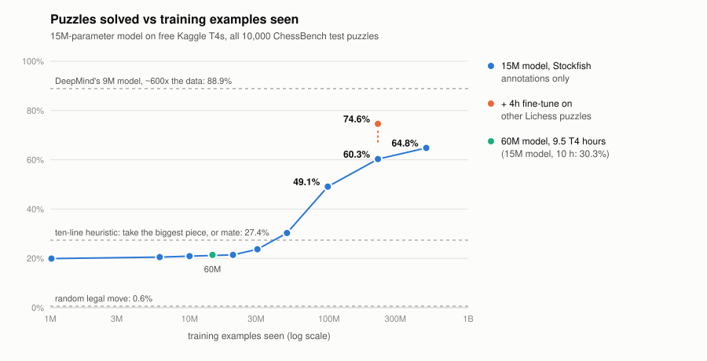

# gpt-from-scratch

A decoder-only Transformer **built from scratch in PyTorch**, pointed at chess, then
made **fast** -- with reproducible configs, benchmarks, and the run logs behind the
numbers in [`results/`](results/).

Every block (attention, MLP, LayerNorm, positional embeddings, the AdamW param
grouping) is hand-written in [`src/model.py`](src/model.py) -- no `from transformers
import` of the model. The fused LayerNorm in [`src/kernels/`](src/kernels/) is
hand-written too, in Triton.

Hand-written is not the same as unprecedented, so: the model's skeleton follows
Karpathy's [nanoGPT](https://github.com/karpathy/nanoGPT) (MIT) and the fused kernel's
two-stage backward follows Triton's `05-layer-norm` tutorial (MIT). The chess task,
the action-value head, the data path, the search and the bot are this project's.
Ideas reimplemented from DeepMind's ChessBench are listed in [`NOTICE`](NOTICE).

## The result

The model reads a chess position and a candidate move and predicts how good the move
is, learning from Stockfish 16 annotations (DeepMind's ChessBench). No search, no
rollouts -- one forward pass per legal move, best expected value wins. 15M parameters
(14.19M non-embedding), 8 layers, 384 dim, a 1,999-symbol vocabulary (31 FEN symbols
plus 1,968 UCI moves), 78 tokens per sample (77 for the position, 1 for the move), and
a 64-way classification head over buckets of the Stockfish win probability.

**60.3% of Lichess puzzles solved** -- 6,029 of the 10,000 ChessBench test puzzles --
after 225M training examples of Stockfish annotations on a free Kaggle T4.

**74.6%** (7,455 of 10,000) after a 4-hour fine-tune on *other* Lichess puzzles, with a
ranking loss over the legal moves added on top of the original one. The 10,000 test
puzzles were excluded by id before packing (9,995 of them are in the Lichess database;
the packer asserts that the exclusion removed something), and the checkpoint was chosen
by the action-value validation loss, never by puzzle accuracy. Both numbers come from
the same session with the same evaluator, one after the other.

Those two numbers answer different questions. 60.3% is what Stockfish's annotations
alone teach, which is the setting of DeepMind's paper. 74.6% is what the model does once
it has also been told which move solves a puzzle -- more useful, and no longer
comparable to the paper, which never trains on puzzles.

Neither is readable without a baseline, which is why the headline here is puzzle
accuracy and not a validation loss. Two baselines run on the same 10,000 puzzles: a
ten-line rule that grabs the most valuable hanging piece, or mates when it can, solves
**27.4%**, and picking a legal move at random solves **0.6%**.

### By difficulty

| puzzle rating | puzzles | grab-the-piece | 100M examples | 225M examples | **+ puzzle fine-tune** |
|---|---|---|---|---|---|
| 0-499 | 74 | 74.3% | 93.2% | 100.0% | **100.0%** |
| 500-999 | 2,161 | 58.3% | 84.4% | 93.6% | **99.4%** |
| 1000-1499 | 3,367 | 32.0% | 61.6% | 76.3% | **93.2%** |
| 1500-1999 | 2,543 | 12.0% | 30.3% | 42.3% | **64.9%** |
| 2000-2499 | 1,571 | 2.8% | 10.8% | 17.4% | **27.4%** |
| 2500-2999 | 284 | 1.1% | 3.2% | 6.0% | **4.9%** |
| **all** | **10,000** | **27.4%** | **49.1%** | **60.3%** | **74.6%** |

(A random legal move solves 0.6% overall; it is not broken out by band.)

The fine-tune gained most in the middle, 1000-2000, and nothing at the top: 6.0% to
4.9% on 284 puzzles is inside the noise of a band that small. Length is the obvious
suspect: the solver has 1.4 moves to find on average below 500 and 3.6 above 2500, and
every one of them has to be right. That is a correlation, not a measured cause.

The gap widens with difficulty -- above 2000 the model is around six times the
heuristic -- and that is the part which cannot be explained by capturing hanging
pieces. Note also what the baseline exposes at the other end: 20.1% of the puzzles
need a single move from the solver, usually a capture, which is exactly the move the
ten-line rule finds.

### The curve

The point of the project is the curve, not the single number -- how much accuracy an
hour of free GPU buys:

<picture>
  <source media="(prefers-color-scheme: dark)" srcset="results/curve_dark.svg">
  
</picture>

| model | examples | T4 hours | puzzles solved | val loss |
|---|---|---|---|---|
| 15M | 1M | 0.2 | 19.9% | 3.234 |
| 15M | 6.1M | 0.9 | 20.5% | 3.088 |
| 15M | 10M | 1.5 | 20.9% | 3.036 |
| 15M | 20.5M | 3.9 | 21.4% | 2.911 |
| 15M | 30.7M | 5.3 | 23.7% | 2.751 |
| 15M | 50M | 10.0 | 30.3% | 2.5432 |
| 15M | 100M | 21.4 | 49.1% | 2.2419 |
| 15M | **225M** | -- | **60.3%** | **2.0557** |
| 15M | 225M + 12k puzzle steps | 4.2 | **74.6%** | 2.0562 |
| 60M | 14.6M | 9.5 (whole run) | 21.4% | 2.986 |

Every row is measured on all 10,000 puzzles, in one Kaggle session with one evaluator
([`results/17_eval_on_kaggle.json`](results/17_eval_on_kaggle.json)); the four rows
that had been measured before came out identical. Earlier drafts had the small runs on
the first 2,000 puzzles only, which turned out half a point to a point easier. The
T4 hours are wall clock from the run logs; the 225M run is warm-started from the 100M
checkpoint and split across two Kaggle sessions, so a single wall-clock figure would
not be comparable -- it held 1,830 samples/s at 20.3% MFU throughout. The fine-tune
row is the training time only; packing the 6.1M-puzzle database took another 65
minutes. Its validation loss is on a different split, so read it as "unchanged",
not as a comparison to four decimals.

**Every model below 50M examples scores worse than the ten-line rule.** That is the
single most useful thing the baseline did.

Returns are diminishing but not gone: doubling from 50M to 100M examples bought 18.8
points, and 2.25x more on top of that bought a further 11.2. Data is not what is
running out -- the 225M run used 82,195,730 positions from 10 of ChessBench's 2,148
shards, held in RAM, and went over them about 1.5 times.

### Per move, not per puzzle

Puzzle accuracy is pass/fail on a whole line. Move by move, on every fully annotated
position of ChessBench's test shard -- 61,833 positions, 1.84M scored moves
([`src/agreement_eval.py`](src/agreement_eval.py)):

| model | action accuracy | picks *a* best move | Stockfish top 3 | Kendall's tau | win prob. given up | moves losing > 15 pts |
|---|---|---|---|---|---|---|
| 1M | 8.5% | 10.9% | 25.3% | 0.190 | 14.2 pts | 29.9% |
| 10M | 14.7% | 17.1% | 34.7% | 0.282 | 11.4 pts | 23.3% |
| 30.7M | 22.2% | 24.7% | 45.9% | 0.381 | 8.4 pts | 16.4% |
| 50M | 30.1% | 32.9% | 55.4% | 0.470 | 5.7 pts | 10.5% |
| 100M | 39.7% | 42.9% | 67.4% | 0.576 | 3.3 pts | 5.2% |
| **225M** | **45.2%** | **48.6%** | **73.7%** | **0.632** | **2.3 pts** | **3.1%** |
| + puzzle fine-tune | 43.1% | 46.5% | 70.4% | 0.619 | 3.0 pts | 5.0% |
| + light puzzle fine-tune | 44.4% | 47.7% | 72.0% | 0.628 | 2.7 pts | 4.2% |

Action accuracy and Kendall's tau (tau-b, over all legal moves, averaged per position)
are the two metrics the ChessBench paper uses in its ablations. Action accuracy is the
paper's definition, the argmax of Stockfish's values; "picks *a* best move" also accepts
a move tied with it, which matters in 5.9% of these positions because win probability
saturates and several moves share the top value. From 50M to 225M examples the rate of
moves that throw away more than 15 points fell from one in ten to one in thirty-two.

**The puzzle fine-tune is not free.** It bought 14.3 points on puzzles and paid for them
in ordinary positions: action accuracy down 2.1 points, and the blunder rate up from
3.1% to 5.0% -- back to the 100M model's level. The action-value loss that ran alongside
the ranking loss limited the damage (tau barely moved, 0.632 to 0.619) but did not
prevent it. With 61,833 positions these differences are far outside the noise.

Turning the ranking loss down removes part of that cost, unevenly. The same fine-tune
with the ranking loss at 0.3 instead of 1.0 -- same data, steps, schedule and card,
only that number changed -- solves **74.4%** of the puzzles (7,436 against 7,455: the
gain is kept). Of the damage it removes about 60% of the action-accuracy drop (0.8
points instead of 2.1) and 70% of tau's (0.003 instead of 0.013), but only 40% of the
extra blunders: 4.2% instead of 5.0%, still 35% more than the 225M model's 3.1%
([`results/20_puzzle_finetune_w0.3.json`](results/20_puzzle_finetune_w0.3.json); the
training logs of both runs are next to it). The blunder differences are 6 to 10
standard errors wide even without pairing the models position by position; the
0.8-point action-accuracy drop is about 3. It is one training run per weight, and a
fine-tune with no ranking loss at all has not been run, so how much of what remains is
the cost of the ranking loss and how much the cost of fine-tuning at all is open.

And they cost games. In a head-to-head match without search
([`src/match.py`](src/match.py): balanced middlegame starts from the held-out test shard,
each played twice with colours swapped), the model **before** the fine-tune beat the one
after it **174-59 with 167 draws over 400 games: +103 Elo, 95% interval +77 to +130**.
Against the light fine-tune, on the same 200 starting positions, it wins 150-93 with 157
draws: **+50 Elo, interval +23 to +77**
([`results/22_match_400_depth1_light.json`](results/22_match_400_depth1_light.json)).
Turning the ranking loss down to 0.3 halved the cost in play, and paired by starting
position the gap between the two matches is 3.0 standard errors -- roughly in line
with the blunders, whose excess over the 225M model it cut by 40%.
With depth-2 search on both sides, on the same 200 starting positions, the full
fine-tune's gap nearly closes: **134-114 with 152 draws, +17 Elo, 95% interval -9 to +44**
([`results/21_match_400_depth2.json`](results/21_match_400_depth2.json)). The two
intervals do not overlap, and paired by starting position the score drop from depth 1
to depth 2 is 4.7 standard errors. Search absorbs most of the fine-tune's cost in
play -- which fits the move-quality table, since the extra errors are one-move
blunders and those are exactly what a two-ply search looks at, though that part is an
explanation, not a measurement. (Each position's two games are not independent; an
interval computed over the 200 colour-swapped pairs instead of the 400 games comes out
within a point of these.) So "better" depends on the job and on the search: for
finding tactics the fine-tuned model; for playing without search the 225M one, by about
a hundred Elo; with depth-2 search, a difference this match cannot resolve. The
first-to-7 match at depth 2 earlier, 7.5-6.5 to the fine-tuned model over 14 games,
was consistent with that and could not have shown it. The 400 games took 8.0 hours on
a T4; on the laptop's CPU the estimate had been about 30.

**Calibrated from the start; what training buys is sharpness.** When the model predicts
a win probability, Stockfish's own number agrees on average: the binned calibration
error is at most 0.007 for every model, the 1M one included. What improves with data is
how close each prediction lands -- mean absolute error 0.125 at 1M examples, 0.036 at
225M, 3.4x smaller. The full predicted distribution is slightly conservative: its
central 50% interval contains Stockfish's value 50-55% of the time and its 90% interval
91-92%, a little more as training goes on.

### Capacity was the wrong lever, and the experiment is in the table

Chinchilla scaling puts the optimum for a 9-hour T4 budget well above 15M parameters;
the 60M model scored 21.4% at 14.6M examples, level with the 15M model at 20.5M
examples and below the same model at 30.7M. Scaling laws are not wrong: the larger model is
roughly 4x slower per step, so it sees far fewer examples per hour, and on this budget
compute per hour is the binding constraint, not parameter count. That would flip on
better hardware -- exactly the kind of thing papers running on clusters never have to
report.

### Distance to the paper

DeepMind's ChessBench reaches **88.9%** on these puzzles with a **9M**-parameter model
-- smaller than this one, on the same data and the same task. The difference is
training examples seen: theirs is roughly 1300x this budget. 60.3% from a free T4 is
a budget result, not an architecture result, and the curve above is the honest way to
read it.

## Search and the Lichess bot

[`src/search.py`](src/search.py) puts alpha-beta (negamax) on top of the network. The
network returns Q(s,a) for every legal move in one batch, which is both the leaf value
(V(s) = max Q) and the move ordering that alpha-beta's pruning lives on: one network
call per node, not one per move. A move's value is the **minimum** of the direct
Q(s,a) and the value backed up from the child, because a maximiser otherwise hunts for
wherever the evaluator is most wrong -- out-of-distribution positions where the network
answers near the mean.

Depth 2 beats the bare network **10-0**, every game by checkmate, over 5 random
openings times 2 colours. It costs 1.5-3 s per move on CPU against 0.03 s for the bare
network.

On puzzles it does the opposite. Same fine-tuned checkpoint, same first 1,000
puzzles, the only difference the search: **74.3% at depth 1, 70.9% at depth 2**
([`results/20_puzzle_finetune_w1.0.log`](results/20_puzzle_finetune_w1.0.log)). The
loss is concentrated where puzzles are easy -- 500-999 drops from 99.0% to 93.7%,
1000-1499 from 93.2% to 86.6% -- while 1500-2499 is level. A game rewards not
hanging pieces over a two-move horizon; a puzzle rewards trusting one move, and a
backed-up value from a position the network sees less clearly can overrule a root
judgement that was right.

Before the fine-tune it was the other way round: on the 225M checkpoint, same 1,000
puzzles, **58.5% at depth 1 and 60.8% at depth 2** -- search helped. So the fine-tune
is what flipped it, and the move-quality table says how: the fine-tune made the values
of ordinary positions worse (blunders 3.1% to 5.0%), and depth-2 search is built out
of exactly those values, read in the position after each candidate move. On their own,
differences of 2-3 points on 1,000 puzzles are suggestive rather than conclusive; what
makes the explanation credible is that it agrees with a measurement on 61,833 positions
that was taken for a different reason. (An earlier depth-2 figure was measured with the
puzzle-parity bug described below and was withdrawn.)

The light fine-tune, with the ranking loss at 0.3, sits in between on both counts: 4.2%
blunders, and on the same 1,000 puzzles **73.2% at depth 1 and 72.6% at depth 2**. In
order -- no fine-tune, ranking loss at 0.3, ranking loss at 1.0 -- search changes the
puzzle score by +2.3, -0.6 and -3.4 points while the blunder rate goes 3.1%, 4.2%,
5.0%. Each of those changes carries a standard error of one to two points on 1,000
puzzles, so this is a trend, not a proof, but it runs the way the explanation
predicts.

[`src/lichess_bot.py`](src/lichess_bot.py) plays the same search online as
**`imbotterthanyou`**: rapid **1634** after 70 rated games, no longer provisional
(24 September 2026) -- the first 18 by the 100M model, the rest by the 225M one. The
fine-tuned model has played 6 games since (3 won, 3 lost), too few to compare. None of
this is comparable to the paper's 2054: that is blitz against bots, this is rapid
against bots -- a different pool at a different time control. Search depth
adapts to the clock -- the bot declines time controls it cannot play at depth 2 and
drops to the bare network when short on time. The API token comes from `LICHESS_TOKEN`
or from `~/.config/lichess/token` with owner-only permissions, which the bot checks and
refuses if they are wider; never a command-line argument, never logged, never inside
the repository.

Running a bot is mostly a lesson in failure modes that look like success. A thread that
died on one dropped connection left the process up, the log open, and the bot silently
challenging nobody for four hours. Catching a network error during a game and returning
kept the process alive and *forfeited* two rated games, since Lichess keeps the clock
running: the fix is to reconnect, not to survive. And a bot cannot enter the lobby or a
tournament -- the API spec says pools and tournaments are off-limits -- so when the bot
pool has spent its 100 daily games, the only lever left is to offer faster time controls
and remember who already said no.

## Quickstart

```bash
python -m venv .venv && source .venv/bin/activate
pip install -r requirements.txt
pytest -q                     # CPU, ~25s: 88 passed, 11 skipped (Triton needs CUDA)
```

Chess, one shard end to end (1.34 GB download, packs to .bin, trains, scores puzzles):

```bash
mkdir -p data/chessbench
BASE=https://storage.googleapis.com/searchless_chess/data
curl -o data/chessbench/action_value-00000.bag \
     $BASE/train/action_value-00000-of-02148_data.bag
curl -o data/chessbench/puzzles.csv $BASE/puzzles.csv

python -c "from src.chess_data import prepare_chessbench; \
           prepare_chessbench(['data/chessbench/action_value-00000.bag'], 'data/chess')"
python -m src.train_chess --config configs/chess.yaml
python -m src.puzzles_eval --ckpt checkpoints/chess_best.pt \
       --puzzles data/chessbench/puzzles.csv --num 10000
```

Any key in the YAML can be overridden on the command line (`--device cpu`,
`--max_steps 5000`, `--batch_size 1024`); an unknown key is reported, not silently
ignored. Training writes `checkpoints/chess_best.pt`.

The language-model path the project started from still works:

```bash
python -c "from src.data import prepare; prepare('data/tinystories.txt', 'data/tinystories')"
python -m src.train --config configs/config.yaml
python -m src.sample --ckpt checkpoints/best.pt --prompt "Once upon a time"
```

Runs are one config plus one command, seeds fixed. GPU runs are assembled into Kaggle
notebooks by [`kaggle_chess/build_chess_notebook.py`](kaggle_chess/build_chess_notebook.py)
and, for runs longer than one 12-hour session,
[`kaggle_chess/build_long_run.py`](kaggle_chess/build_long_run.py).

## Systems

Throughput on a T4, measured with [`src/bench_chess.py`](src/bench_chess.py)
(each configuration in its own subprocess):

| change | samples/s | MFU |
|---|---|---|
| baseline | 1537 | 17.1% |
| + fused AdamW | 1750 | 19.5% |
| + torch.compile, batch 1024 | **1849** | **20.6%** |

The fused LayerNorm ([`src/kernels/layernorm.py`](src/kernels/layernorm.py)) against
PyTorch, at the model's shapes:

| rows | eager | torch.compile | Triton | bandwidth |
|---|---|---|---|---|
| 9,984 | 1.00x | 0.93x | 0.86x | 147 GB/s |
| 39,936 | 1.00x | 1.71x | **1.86x** | 298 GB/s |
| 79,872 | 1.00x | 1.40x | **1.48x** | 295 GB/s |

295-298 GB/s is about 92% of the T4's 320 GB/s ceiling, so for a memory-bound op there
is little left on the table: the kernel is 1.5-1.9x over eager and 5-8% over
torch.compile at the sizes that matter. Below ~10k rows it *loses* to eager -- launch
overhead outweighs the win -- which is why the PyTorch fallback stays in.

The honest ceiling: end to end that kernel is worth about **3%** (a 2,000-step A/B on
the T4 ran 681 s with the PyTorch LayerNorm and 661 s with the Triton one,
[`results/07_triton_layernorm.log`](results/07_triton_layernorm.log)). LayerNorm is a
small share of the step. Amdahl. And the GEMMs that dominate it are not reachable from
here either: on a T4 torch.compile logs `Not enough SMs to use max_autotune_gemm mode`
and skips the autotuned GEMM templates altogether, so what `compile` buys on this card
is fusion and fewer launches.

### Two GPUs, not one

Kaggle's "GPU" accelerator is two T4s -- a single T4 is not offered (kaggle-cli PR
1198) -- and the weekly quota counts the session, not the cards. Every run above
trained on one of the two. The same session, the same data, the same starting
checkpoint, measured back to back
([`results/23_one_vs_two_t4.log`](results/23_one_vs_two_t4.log)):

| | samples/s | MFU per GPU |
|---|---|---|
| one T4 | 1,907 | 21.2% |
| two T4s, DDP, global batch still 1024 | **3,546** | 19.8% |

1.86x, 93% scaling efficiency, at no extra quota (every log line from step 200 on, once
compilation is over). The ranks read disjoint slices of the data and seed the same RNG,
so the RNG state one rank saves is every rank's and a run split across sessions still
matches an unsplit one bit for bit (`tests/test_ddp.py`, on two gloo ranks).

The same numbers settle what an earlier draft of this section got wrong. It guessed
that the step was bound by kernel launches and wanted CUDA graphs next. A launch-bound
step costs the same whatever the batch; here each card's step fell from 0.537 s to
0.289 s when its batch halved from 1,024 to 512. The fixed part -- launches and the
gradient all-reduce together -- is at most 0.289 - 0.537/2 = 20 ms of 289, about 7%, and
that is all CUDA graphs could win. The step is bound by the work itself.

## What was learned the hard way

Documented because the mistakes were more instructive than the successes:

- **A warm restart is not free.** The 225M run started from the 100M checkpoint with a
  fresh cosine at lr 5e-4. Validation loss went *up*, from 2.2412 to 2.4834 in 8,000
  steps, and it took about 52,000 steps just to get back to where it started. All of
  the gain arrived in the final third, as the learning rate decayed. The lesson is
  budgetary: if the budget cannot cover the whole decay, restarting is worse than not
  restarting. It held at a fifth of the learning rate too: the puzzle fine-tune, at
  1e-4, still lifted the validation loss from 2.043 to 2.150 in its first 3,000 steps
  and only got it back as the schedule decayed.
- A throughput number that counts only one of two batches halves itself. The fine-tune
  logged 822 samples/s at 9% MFU because the puzzle batch -- as many sequences again --
  was not counted; it looked exactly like a regression.
- `torch.cuda.is_bf16_supported()` counts emulation and answers `True` on a T4, where
  bf16 is emulated and slow. Detect the card by compute capability instead: worth 4.1x.
- The same metric was got wrong twice, in opposite directions. Lichess puzzle files
  give the position *before* the opponent's move, so the solver plays the odd plies.
  A first version read it right; a "fix" then flipped it, on the evidence that
  `Moves[0]` matched the first move of the `Solution` column -- which is that same
  line written in another notation, so the check could only agree. For ten days every
  reported accuracy was the model guessing the *opponent's* moves. What settled it:
  ChessBench's file is byte-identical to `lichess_db_puzzle` for the same PuzzleId,
  and DeepMind's own evaluator asks the engine on odd plies. The lesson is not about
  chess: **a test that compares a field with a restatement of itself will certify
  anything.** The replacement asks who ends up checkmated.
- A metric without a baseline is not a measurement. Until a ten-line heuristic was run
  on the same puzzles, there was no way to know that most models here were below it.
- Timing a training step without `torch.cuda.synchronize()` measures how long the CPU
  took to *queue* the work. It reported an MFU of 882%.
- Benchmarking configurations in one process lets the first one leave the allocator
  fragmented; a larger batch then looks slower, and OOMs on an allocation the card
  has room for.
- A CPU-only test cannot catch a device-placement bug: resuming loaded the whole
  checkpoint onto the GPU, RNG state included, and `torch.set_rng_state` refused it.
  Running the same test on MPS reproduced it locally.
- A mutation check can be fooled by a stale `.pyc`: the mutated and restored files had
  the same size and the same mtime second, so Python reused the old bytecode and the
  "restored" run still failed.
- Read the hardware before tuning for it. For a month every run here trained on one
  of the two T4s Kaggle's GPU sessions come with, while the kernels and the batch size
  were being tuned for "the T4": `torch.cuda.device_count()` would have said 2 on the
  first day.
- Deeper search does not average out evaluator error, it amplifies it. Alpha-beta
  actively searches for the positions where the network is most wrong, which is why a
  move is scored by the minimum of its two estimates rather than the backed-up one.

## Layout

```
src/model.py         hand-written GPT (attention, MLP, LayerNorm, generate)
src/chess_data.py    ChessBench .bag reader, FEN tokenizer, 1968-move vocabulary
src/train_chess.py   action-value training loop (resume, warm restart, deadlines)
src/puzzles_eval.py  Lichess puzzle accuracy
src/puzzle_data.py   Lichess puzzle database -> a ranking task (held-out ids excluded)
src/agreement_eval.py  per-move agreement with Stockfish
src/search.py        alpha-beta on top of the network
src/match.py         head-to-head matches between two checkpoints, Elo with an interval
src/lichess_bot.py   plays online; token from the environment or an owner-only file
src/kernels/         fused LayerNorm in Triton + its bench
src/bench_chess.py   throughput bench (isolated subprocess per config)
src/data.py          BPE tokenizer + streaming corpus packing
src/train.py         language-model training loop
kaggle_chess/        builds the Kaggle notebooks (training, fine-tunes, evaluation, matches)
results/             the logs behind the numbers above
```

## Still open

- A fine-tune with the ranking loss switched off, to split what remains of the cost
  between the ranking loss and the fine-tune itself
- KV-cache serving for the language-model path (CUDA graphs: worth at most ~7% here,
  see Systems)
